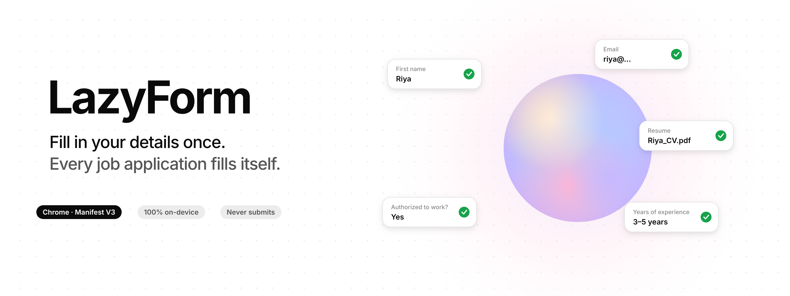
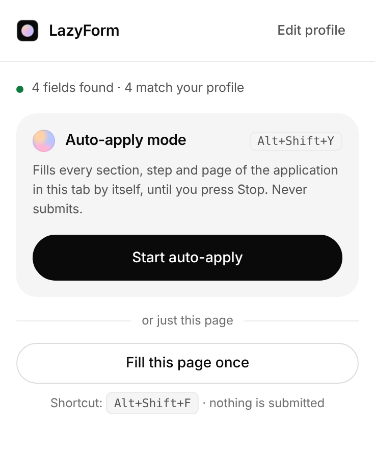
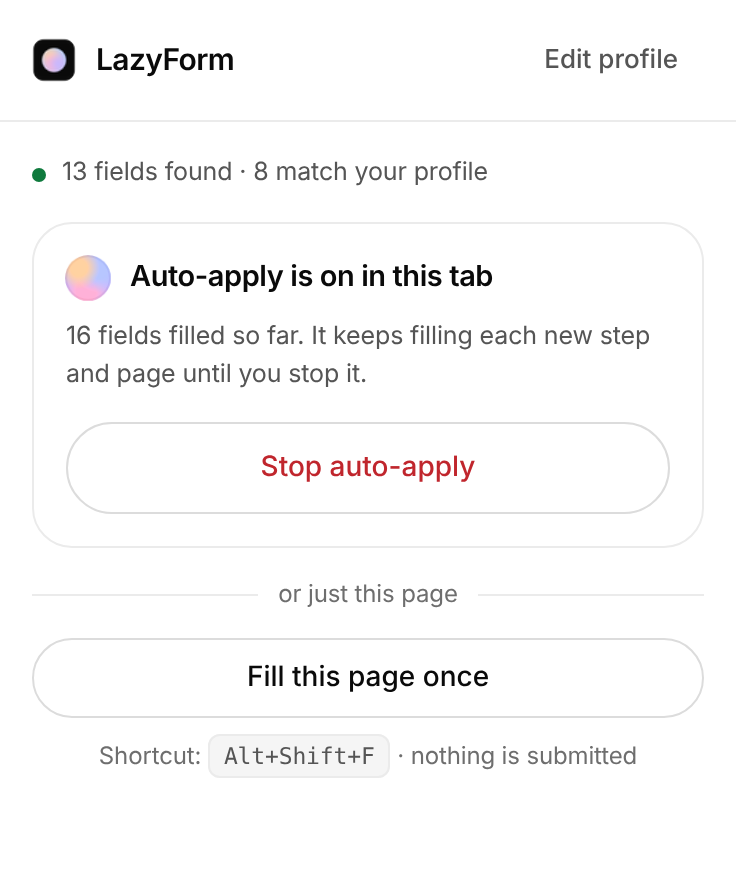
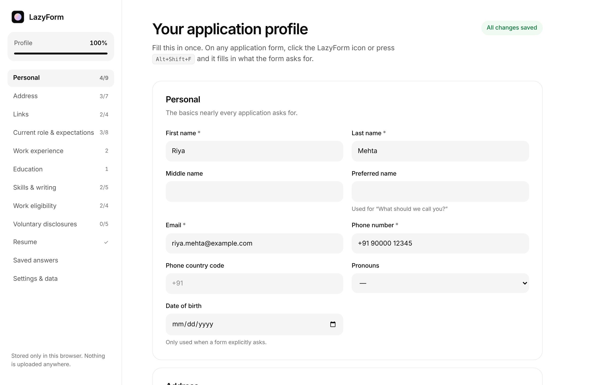
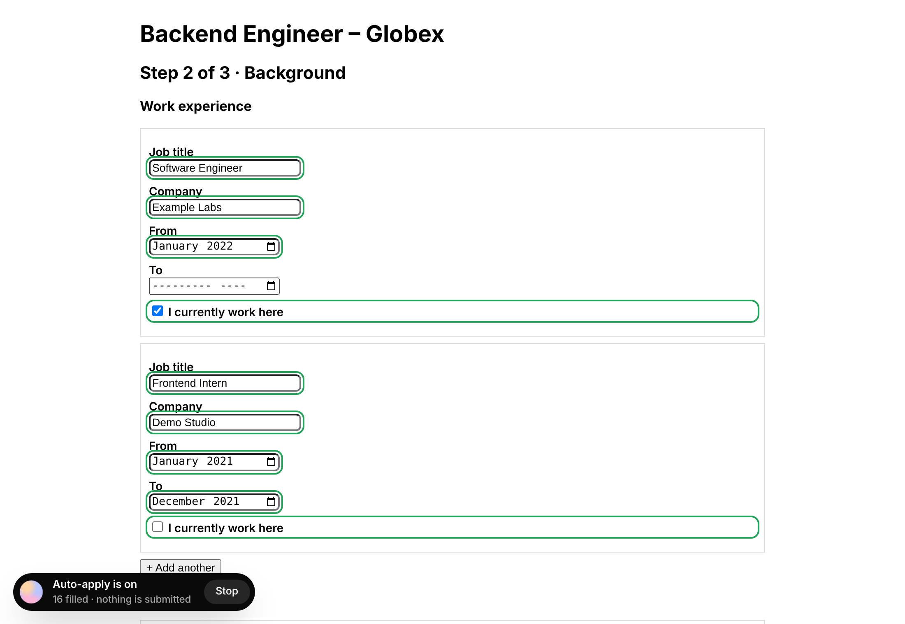

<div align="center">

<picture>
  <source media="(prefers-color-scheme: dark)" srcset="docs/assets/hero-dark.png">
  
</picture>

<br>

[](#-install)
[](#-privacy)
[](#-tested-in-a-real-browser)
[](LICENSE)

**[⬇ Download](dist/lazyform-extension.zip)** &nbsp;·&nbsp; **[⚙ Install](#-install)** &nbsp;·&nbsp; **[◐ How it works](#-how-it-works)** &nbsp;·&nbsp; **[⛨ Privacy](#-privacy)**

</div>

<br>

> **LazyForm** is a Chrome extension for people who are tired of typing the same name, email, work history and "Are you authorized to work?" answer into every job portal.
> You save your profile once. On any application, LazyForm reads each question, works out what it's asking, and fills it in. Turn on **auto-apply mode** and it keeps going through every step and page until you press Stop.

<br>

## ✦ Highlights

<table>
<tr>
<td width="33%" valign="top">

### ◉ &nbsp;Auto-apply mode
Switch it on once per tab. It fills each section, each **Next** step, newly added blocks and the next page, then stops when you say so.

</td>
<td width="33%" valign="top">

### ◎ &nbsp;Understands questions
Reads labels, ARIA, placeholders, nearby text and the section heading. Handles "5–10 years" ranges, "I am / I am not" wording and Workday-style pickers.

</td>
<td width="33%" valign="top">

### ⛨ &nbsp;Private by design
No server, no analytics, no network calls. Your profile and resume live in `chrome.storage.local` and nowhere else.

</td>
</tr>
<tr>
<td valign="top">

### ✓ &nbsp;You stay in control
It **never submits**, never ticks consent boxes and never overwrites something you typed. Green outline = filled, amber = needs you.

</td>
<td valign="top">

### ↻ &nbsp;Learns as you go
Answer a new question yourself, click **Save my new answers**, and it fills that question on the next application.

</td>
<td valign="top">

### ⌘ &nbsp;Keyboard first
<kbd>Alt</kbd>+<kbd>Shift</kbd>+<kbd>F</kbd> fills the page. <kbd>Alt</kbd>+<kbd>Shift</kbd>+<kbd>Y</kbd> toggles auto-apply.

</td>
</tr>
</table>

<br>

## ◐ Look and feel

<div align="center">

&nbsp;

</div>

<br>

<picture>
  <source media="(prefers-color-scheme: dark)" srcset="docs/assets/setup-dark.png">
  
</picture>

<p align="center"><sub>The setup page follows your system theme: light or dark. Everything autosaves as you type.</sub></p>

<br>



<p align="center"><sub>Auto-apply mode filling step 2 of a career page: two jobs and an education block, each in the right slot.</sub></p>

<br>

## ⚙ Install

LazyForm isn't on the Chrome Web Store yet, so you load it yourself. It takes about two minutes.

| Step | What to do |
| :---: | --- |
| **①** | Download **[`lazyform-extension.zip`](dist/lazyform-extension.zip)** and unzip it into a folder you'll keep. |
| **②** | Open `chrome://extensions` and switch on **Developer mode** (top right). |
| **③** | Click **Load unpacked** and pick the unzipped folder (the one with `manifest.json`). |
| **④** | The setup page opens. Fill in your details and drop in your resume. |
| **⑤** | Pin the LazyForm icon from the puzzle-piece menu. |

> **Updating:** replace the folder with the new version and press **↻ Reload** on the LazyForm card in `chrome://extensions`. Your profile is kept.

<br>

## ▶ Use

```text
Open a job application
        │
        ├──▶  Click the LazyForm icon ─▶ Start auto-apply     (fills every step & page until Stop)
        │
        └──▶  …or press Alt+Shift+F                            (fills just this page, once)
```

| You'll see | Meaning |
| --- | --- |
| 🟩 **Green outline** | Filled by LazyForm |
| 🟧 **Dashed amber outline** | Needs you: consent boxes, unknown required questions, dropdowns it couldn't match |
| ⬤ **Bar in the corner** | Auto-apply is on, with a live count and a **Stop** button |

**What it fills:** name, email, phone, address, LinkedIn / GitHub / portfolio, current role, years of experience, notice period, start date, salary, work authorization, sponsorship, relocation, education, skills, summary, cover letter, diversity questions (only if you set them), your resume file, multiple jobs and degrees, and any answers you've saved.

**What it never does:** submit forms · tick consent or "I certify" boxes · fill hidden trap fields · fill or remember ID, bank or card numbers · reuse an answer that names one company on another company's form.

<br>

